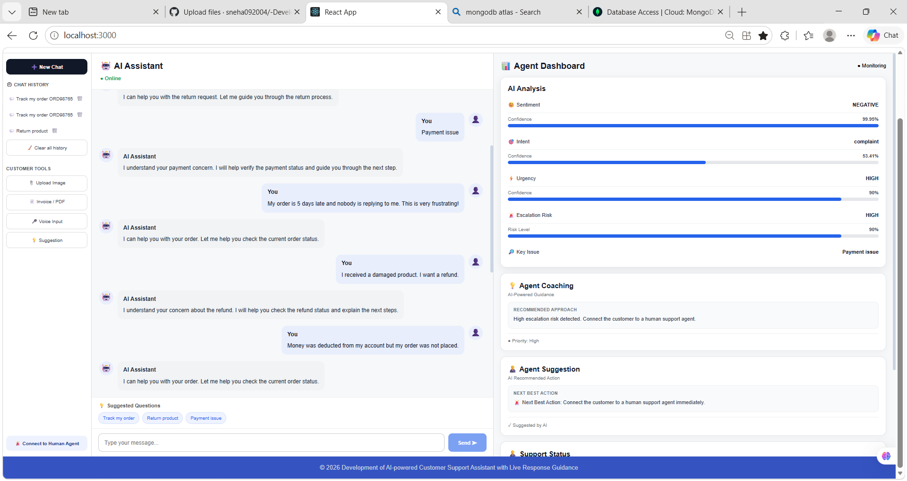
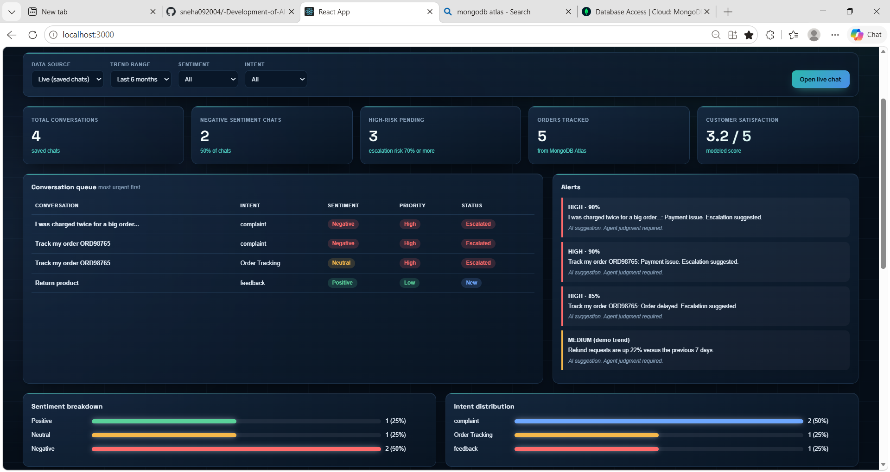

# AI-Powered Customer Support Assistant with Live Response Guidance

A web app that helps customer support agents reply faster and better. It reads each customer message, detects **sentiment** and **intent**, and shows live reply suggestions to the agent.

Built during my internship at **Infosys Springboard** (22 July - 29 September 2026), mentored by Mrs. Amrita A.

## Screenshots

<!-- Add 2-3 screenshots in a "screenshots" folder, then keep or edit these lines -->



## Features

- **Sentiment analysis** of customer messages (DistilBERT)
- **Intent classification** using zero-shot learning (DistilBART)
- **Agent Dashboard** showing sentiment, intent and suggested replies
- **Editable draft replies**: suggestions fill the input box so the agent can review before sending
- **Multilingual UI** with a language selector
- **Voice input** using the Web Speech API (works best in Chrome)
- **Chat history** saved in the browser with `localStorage`
- **Order tracking** with data from MongoDB Atlas

## Tech Stack

| Part | Tools |
|---|---|
| Frontend | React, react-leaflet, Leaflet |
| Backend | Python, Flask |
| AI / NLP | HuggingFace Transformers (DistilBERT, DistilBART), pypdf |
| Database | MongoDB Atlas |
| Browser APIs | Web Speech API, localStorage |

## Project Structure

```
.
├── backend/
│   ├── app.py             # Flask server and API routes
│   ├── ai_logic.py        # Sentiment, intent and response logic
│   ├── requirements.txt   # Python packages
│   └── .env.example       # Template for environment variables
├── public/
├── src/
│   ├── App.js             # Main React app
│   └── translations.js    # Language translations
├── package.json
└── README.md
```

## How to Run

### 1. Clone the repo
```bash
git clone https://github.com/sneha092004/-Development-of-AI-powered-Customer-Support-Assistant-with-Live-Response-Guidance.git
cd -Development-of-AI-powered-Customer-Support-Assistant-with-Live-Response-Guidance
```

### 2. Backend
```bash
cd backend
pip install -r requirements.txt
cp .env.example .env        # then add your MongoDB connection string
python app.py
```
The first run downloads the HuggingFace models, so it can take a few minutes.

### 3. Frontend
Open a new terminal in the project root:
```bash
npm install
npm start
```
Open http://localhost:3000 in **Chrome**.

## How It Works

1. The customer sends a message from the chat screen.
2. The Flask `/chat` route passes it to `ai_logic.py`.
3. DistilBERT detects the sentiment and DistilBART detects the intent.
4. The Agent Dashboard shows the result with a suggested reply.
5. The agent edits the draft and sends it.

## Known Notes

- Voice input can be unreliable in Edge on localhost. Use Chrome.
- If the dashboard shows blank values, clear old chat history: run `localStorage.clear()` in the browser console.

## Future Improvements

- More dashboard widgets
- Support for more languages and intents
- Deploy the app online

## Author

**Sneha Singh**, B.Tech AI & DS
GitHub: [sneha092004](https://github.com/sneha092004)
